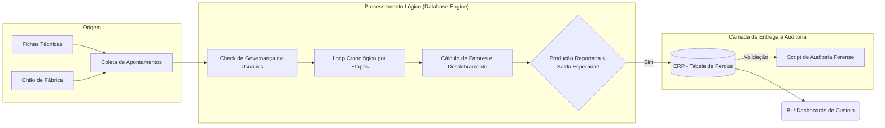

# Otimização do Balanço de Massa e Apontamento de Perdas

## 📌 O Desafio de Negócio (Contexto)
Na indústria de manufatura contínua (com forte foco no fluxo flexográfico), ocorrem divergências constantes entre a matéria-prima inserida e a quantidade de produto acabado reportado. Anteriormente, as perdas de material entre etapas produtivas (Extrusão, Impressão, Corte) dependiam do apontamento manual dos operadores. Isso gerava inconsistências nos balanços de massa, ofuscava os gargalos no chão de fábrica e deturpava o custo real (CMV) das Ordens de Produção (OPs).

## 🎯 O Objetivo
- Automatizar o apontamento de perdas "ocultas" (parasitas) que não eram reportadas manualmente.
- Ajustar os cálculos dinamicamente considerando processos complexos (ex: desdobramento de bobinas/pistas).
- Validar as conversões de unidade de medida entre a matéria-prima e o produto final de forma sistêmica.
- Disponibilizar um **Módulo de Auditoria Forense** para rastreabilidade e homologação dos cálculos.

## 📐 Arquitetura do Fluxo de Dados

## 🛠️ A Solução Técnica

1. O repositório é composto por dois artefatos principais:

2. Motor Transacional (automation_trigger.sql): Procedure acionada no encerramento de OPs que injeta perdas sistêmicas calculadas de forma idempotente.

3. Auditor Forense (audit_hidden_losses_forensic.sql): Script de diagnóstico com saída via DBMS_OUTPUT que simula o comportamento do motor passo a passo para qualquer OP fechada, permitindo comparar o volume esperado pela engenharia contra o reportado pelo operador.

## 🚀 Impacto Esperado (ou Real)

* Fechamento de Custos Preciso: Visibilidade real do desperdício de insumos por etapa.

* Transparência e Debug Rápido: O script de auditoria permite que a equipe de engenharia valide inconsistências apontadas pelo chão de fábrica em segundos.

* Governança Fortalecida: Trava lógica bloqueando usuários não autorizados de burlar fluxos críticos sem aval do PPCP.
