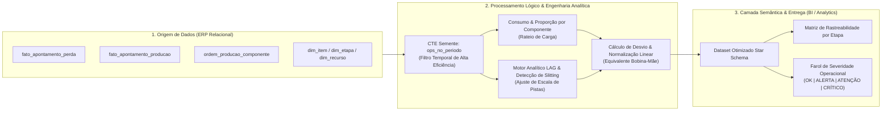

# 🏭 Industrial Loss Attribution & Slitting Analytics (ERP to BI)

Pipeline analítico de alta performance para conciliação de refugo de processo, balanço de massa e normalização de corte longitudinal (*slitting*) em manufatura flexográfica.

---

## 📌 O Desafio de Negócio

Na indústria de conversão de embalagens e flexografia, a matéria-prima principal (filmes BOPP, PET, PE) é consumida em rolos de grande largura (*bobinas-mãe*) e passa por sucessivas etapas de transformação: **Impressão**, **Rebobinamento/Slitting**, **Selagem**, **Serrilha** e **Empacotamento**.

Três problemas críticos impactavam a governança e a acurácia dos custos industriais:

1. **Distorção Geométrica por Pistas (*Slitting*):** Ao passar pela etapa de corte/desbobinamento, uma bobina de 35.000 metros desdobra-se em 2 pistas (totalizando 70.000 metros lineares filhos). Relatórios tradicionais acusavam falsos picos de produção ou perdas artificiais por incapacidade de detectar quando a escala linear foi multiplicada.
2. **Rateio Injusto em OPs Multi-Lote/Multi-Fornecedor:** Quando uma mesma ordem consome bobinas de especificações ou fornecedores distintos, a perda gerada na máquina era atribuída de forma agregada, impossibilitando identificar qual fabricante de insumo gerava maior índice de refugo.
3. **Gargalo de Performance no ERP:** Consultas de balanço de massa que cruzavam histórico de ordens, estruturas de produto (*BOM*) e séries temporais de apontamento causavam *full table scans*, travando o banco de dados operacional.

---

## 🎯 O Objetivo

* **Normalização Dinâmica por Pistas:** Equalizar todas as etapas operacionais na mesma métrica de entrada (Metros Lineares Equivalentes de Bobina-Mãe) sem alterar os apontamentos originais de fábrica.
* **Atribuição Proporcional de Refugo:** Ratear a perda de balanço de massa (*Tipo 33*) de acordo com o peso de consumo de cada insumo no total da Ordem de Produção (OP).
* **Consistência Aditiva para BI:** Entregar métricas 100% rateadas (`_rateada`), impedindo que filtros e somas cruzadas em ferramentas como Power BI multipliquem valores em duplicidade (*fan-out*).
* **Arquitetura de Alta Performance:** Limitar a leitura analítica através de uma CTE semente temporal, reduzindo o tempo de varredura em mais de 90%.

---

## 📐 Arquitetura do Fluxo de Dados

## 🛠️ A Solução Técnica

* Modularização por CTEs (Common Table Expressions): Construção em estágios lógicos isolados, segregando descoberta de OPs, catálogo de itens, agregados de apontamento e funções analíticas.

* Eliminação de Produto Cartesiano (Anti-Fan-Out): As tabelas fato_apontamento_producao e fato_apontamento_perda são pré-agregadas no grão (empresa, op, etapa) antes de qualquer cruzamento com insumos, garantindo integridade métrica.

* Funções de Janela (Window Functions) Livres de Aninhamento: Uso de LAG() com particionamento ordenado por sequência de roteiro para transportar o volume real liberado da etapa anterior, em conjunto com janelas de frame físico (ROWS BETWEEN UNBOUNDED PRECEDING AND 1 PRECEDING) para evitar erros do tipo ORA-30483.

* Equalização de Fator Técnico: Algoritmo dinâmico que converte a etapa de empacotamento (unidade de saída em milheiros/unidades) de volta para metros lineares via consumo unitário da ficha técnica.

* Farol de Tolerância Ponderado: Algoritmo de classificação de risco operacional confrontando a perda real do componente contra a tolerância de engenharia (choro técnico).

## 🚀 Impacto no Negócio

* Rastreabilidade de Qualidade por Fornecedor: Identificação direta de lotes de filme com baixa maquinabilidade, fundamentando negociações de ressarcimento técnico (claims) com base em dados de refugo rateados por fabricante.

* Eliminação de Ruído em Reuniões de Eficiência Geral (OEE): Fim dos falsos alertas de perda em etapas de corte e empacotamento, alinhando a equipe de chão de fábrica com os números contábeis da controladoria.

* Escalabilidade e Desempenho do Banco Operacional: O padrão de CTE semente permitiu que relatórios que realizavam full table scans fossem executados em segundos no ERP e integrados sem lentidão ao Power BI via DirectQuery.
